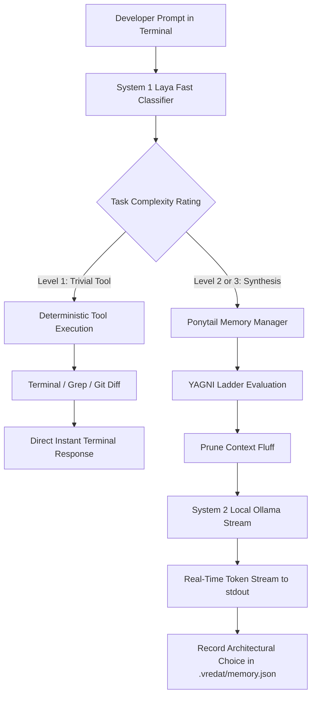

# Vredat Execution Flows & Setup Runbook

## 1. Intent Routing & Execution Flow



---

## 2. Setup Guide

### Prerequisites
* Python 3.10+
* [Ollama](https://ollama.ai) installed and running locally
* `ollama pull llama3.2:1b` (or `qwen2.5-coder:1.5b-instruct`)

```bash
# Clone repository
git clone https://github.com/pranav520214/vredat.git
cd vredat

# Install in editable mode
pip install -e .

# Launch Vredat from anywhere
vredat
```

---

## 3. Command Usage

```bash
# Interactive REPL mode:
vredat

# Single command execution:
vredat "find all TODO items in this repo"
vredat "refactor engine_llm.py to handle connection timeouts"

# Alias check:
verdeta --status
```
